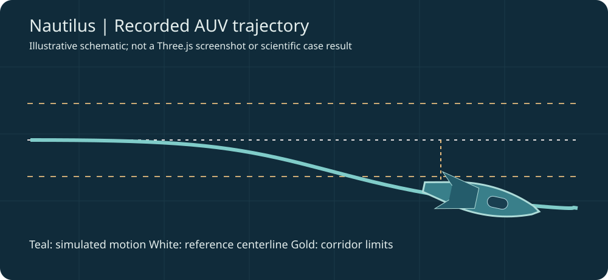

# Nautilus

Agentic failure investigation and evidence-based controller engineering for simulated underwater robots.

[Live workbench](https://nautilus-demo-delta.vercel.app/) | [Source repository](https://github.com/RatChakraborty/MetaGlobalAIDeveloperHackathon-Nautilus)

Nautilus is an engineering research prototype developed for the Meta Global AI Developer Hackathon 2026. It connects a physics-based planar underwater-vehicle simulator, numerical fault diagnosis, experiment planning, bounded controller engineering, auditable evidence, a Three.js AUV replay viewer, and authentic recorded Meta Muse tool activity.

All robot motion and engineering results are simulated. Nautilus does not claim physical deployment, hardware validation, or a certified repair.

## The problem

An autonomous underwater vehicle inspecting an offshore pipeline begins drifting off course. Ocean currents, failing thrusters, and faulty heading measurements may produce similar observations, but require different engineering responses. Nautilus compares competing explanations and tests controller interventions numerically rather than trusting an unsupported agent assertion.

## End-to-end workflow

Run → Investigate → Engineer → Verify → Report

1. Run reproducible 3-DOF surge, sway, and yaw simulations with explicit disturbances and random seeds.
2. Investigate public measurements through competing physical hypotheses, residual comparisons, ambiguity handling, and bounded experimental probes.
3. Engineer a controller revision with Policy Studio, using the evidence-preserving Engineer this failure handoff or a distinct host-defined example candidate.
4. Verify the source and parameters, run matched baseline-versus-candidate trials, check predeclared acceptance gates, and evaluate held-out robustness.
5. Report with linked investigation records, evidence hashes, controller fingerprints, source/parameter diffs, and canonical host JSON preserved across export and reimport.

The browser destinations are Overview, Run and Investigate, Evidence, Engineer, History, and Reports.

## Features

### Simulator and numerical investigation

- Simplified 3-DOF marine dynamics with hydrodynamic damping, thrust commands, and corridor-following control.
- Configurable lateral current, independent port/starboard efficiencies, heading bias, observation noise, and deterministic seeds.
- Public observations include lateral position, heading, yaw rate, and commanded thrust. Hidden simulation truth and world-frame longitudinal position are not public diagnostic telemetry.
- Numerical fitting of competing fault hypotheses, evidence tables, uncertainty and ambiguity, and bounded experimental actions.
- Public experiment history, action references, session identity, and reproducible evidence ledger.

### Controller engineering and trusted evaluation

- Investigation-to-Policy-Studio handoff preserving public observations, hypothesis evidence, identifiability limits, and run references.
- Restricted source/parameter edits with trusted validation and exact controller fingerprints.
- Matched paired baseline/candidate simulations, tracking and effort metrics, development acceptance gates, and separate held-out checks.
- Host-enforced final recommendation, not a conclusion generated by a model.
- Engineering traces, policy comparisons, reports, and canonical hash-sensitive evidence exports.

### Meta Muse agent integration

Meta Muse is connected through bounded tool interfaces for parameter proposals and requests for numerical evaluation. An authentic, sanitized real development recording is presented on Overview. The C1 and C2 proposals and the corresponding host validations, paired trials, robustness checks, and final host decision are visible as recorded events.

The recording is not a fresh model call. Offline scripted workflows are labeled as scripted, and live paid Muse engineering is disabled by default in the public workbench. Model output never overrides trusted numerical gates or executes arbitrary generated controller Python.

### Three.js underwater vehicle replay

The existing viewer supports an illustrative research AUV model, underwater environment, recorded trajectory playback, Play/Pause and timeline controls, reset camera, presentation mode, chase/onboard/top/free and inspection cameras, motion trails, corridor reference and breach overlays, optional matched reference comparison, controller provenance, graphics quality, and commanded-thrust overlays when supported by a matching record.

This viewer replays recorded simulator pose. It is not a second simulator or a real camera feed. Public live observations omit longitudinal position, so spatial motion requires a separate matching visualization companion.

*Illustrative schematic, not an actual screenshot or scientific result. To see the rendered research AUV, load a compatible recording in the interactive browser viewer.*

#### Generate a real simulator-backed replay

From the repository root, after installing Python dependencies:

~~~bash
python scripts/generate_nautilus_replay.py --output ~/Downloads/nautilus-replay
~~~

This creates real simulator-derived disturbance and nominal-reference runs, each with a public investigation JSON and separate visualization-only JSON. Spatial simulator truth is never inserted into public investigator observations.

To view the disturbance:

1. On the website expand Advanced - Load an external recording in the left rail and select disturbance.public.json.
2. Navigate to Run and Investigate → Recorded visualization.
3. Click Load visualization file and select disturbance.visualization.json.
4. Use Play/Pause, timeline seeking, Camera, Reset view, and the corridor overlays.
5. Optionally load reference.public.json then reference.visualization.json under Reference comparison & visualization provenance.

These are separately generated simulator demonstrations, not Cases A/B/C and not evidence of a repaired real vehicle.

## Scientific demonstrations

These represent distinct studies; their measurements must not be conflated.

| Study | Mode | Evidence-backed outcome |
| --- | --- | --- |
| Case A: Ambiguous drift | Fresh deterministic passive diagnosis | Five declared hypotheses fit; kind=ambiguous and selected=null. This is passive protocol ambiguity, not a Muse abstention. |
| Case B: Bounded integral revision | Host-proposed deterministic controller evaluation | Mean RMS tracking error improves from 0.994 m to 0.410 m; 8/8 predeclared development gates pass; held-out mean improvement is about 0.493 m. It was not Muse-proposed. |
| Case C: Aggressive lookahead rejected | Recorded controller development study | A 14 m lookahead candidate loses to the 7 m baseline on three development scenarios; 5.02 m vs 2.68 m RMS in the first. Inputs for this historical study are private. |
| Recorded real Muse | Authentic recorded model/tool interactions | Muse-proposed parameter changes and host-run numerical evaluations. No live model call occurs when replaying. |

Original case artifacts are in [frontend/public/evidence/](frontend/public/evidence/), and the sanitized Muse recording is in [frontend/public/recorded/muse-engineering-run.json](frontend/public/recorded/muse-engineering-run.json).

## Architecture

~~~text
TypeScript / Vite browser UI
   |  investigations, evidence, engineering, reports, 3D recorded replay
   v
Trusted Python API
   |  planar simulator and public telemetry
   |  fault-model fitting and bounded experiments
   |  hash-linked evidence and investigation-to-engineer handoff
   |  candidate validation, matched trials, held-out robustness
   v
Host-enforced numerical decision and engineering report

Meta Muse or offline scripted agent -> validated host tool interface
Visualization-only simulator pose -> Three.js viewer, never diagnostic input
~~~

## Install and run

Requires Python 3.10+ and a compatible Node.js release.

~~~bash
python -m venv .venv
.venv/bin/python -m pip install -e '.[dev]'
~~~

API terminal:

~~~bash
.venv/bin/python -m nautilus_api.server 8000
~~~

Frontend terminal:

~~~bash
cd frontend
npm ci
npm run dev
~~~

Open http://127.0.0.1:3000/. Vite proxies API requests to port 8000 in development.

## Testing and limits

~~~bash
.venv/bin/python -m pytest -q -p no:cacheprovider
cd frontend
npm test
npm run build
~~~

At the integrated-release checkpoint, agents reported 159 passing frontend tests, 114 release-critical Python/API tests, 646 broader Python tests, and a successful TypeScript/production build. Nine Git-metadata failures and 30 Redis setup errors affected environment-dependent checks. The canonical export/import and linked deterministic numerical workflow passed focused checks. These are prior checkpoint results, not a new test run.

- Simulation only; no hardware validation, deployment, field repair, or safety certification.
- Fault scores are heuristic, not calibrated probabilities; controller improvement does not prove the physical cause.
- Some historical study inputs are private; recorded evidence is not always fully regenerable from the public tree.
- The 3D replay uses simulation truth for presentation, never as investigator evidence.
- Browser session history is in-memory; export records before refreshing.
- Live paid model access requires explicit server-side authorization, credentials, and budget controls, and is disabled by default.

## Security and license

Keep MODEL_API_KEY, NAUTILUS_DEMO_TOKEN, Upstash credentials, private evaluation fixtures, and hidden truth outside version control. See [.env.example](.env.example) for variable names, not values. See [LICENSE](LICENSE) for license terms.
